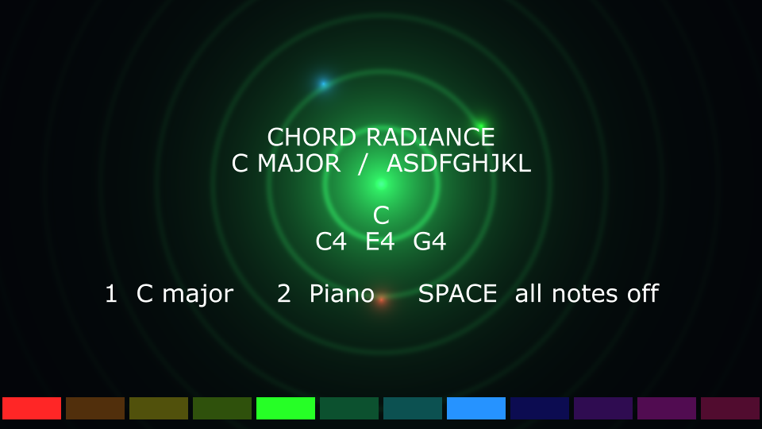

# Chord Radiance

A rudimentary TouchDesigner keyboard instrument: polyphonic sound, a color for each note, and an animated chord glow blended in HSV.

## Play

1. Download [ChordRadiance.tox](chord_visualizer/ChordRadiance.tox) and drag it into a TouchDesigner network.
2. Right-click the component, choose **View**, then click inside its viewer. Keep the timeline playing.
3. Press **1** for C major on `ASDFGHJKL`, or **2** for chromatic piano order on `AWSEDRFTGYJUIKOL`.
4. Hold multiple keys for a chord. Press **Space** to stop all notes.

In C major mode, hold **A+D+G** for C4/E4/G4. In piano mode, hold **A+D+T** for the same chord.

The Instrument parameter page provides Layout, Volume, and Audio Enabled. Notes sound through the default audio output. No additional packages or assets are required.

## Colors

Twelve note colors run around the HSV hue wheel, starting with red for C. Each held note has its own satellite; their circular hue average colors the radiating center. Octaves share a color. This is a creative color mapping. Basic chord names and note names are displayed.

[Full setup and exact key mapping](chord_visualizer/readme.txt) · [Color map](chord_visualizer/color_map.json) · [Source](chord_visualizer/engine.py) · [Verification](chord_visualizer/verification.json)

Built and checked in TouchDesigner 2023.12370 on macOS. Mapping, nonzero finite audio samples, rendering, and reload under a different name passed with no operator errors. Physical speaker playback was not listened to.
